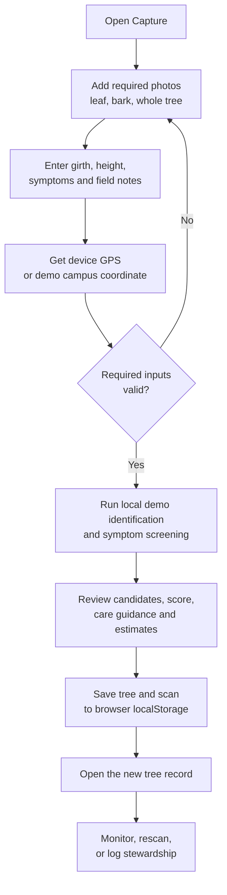
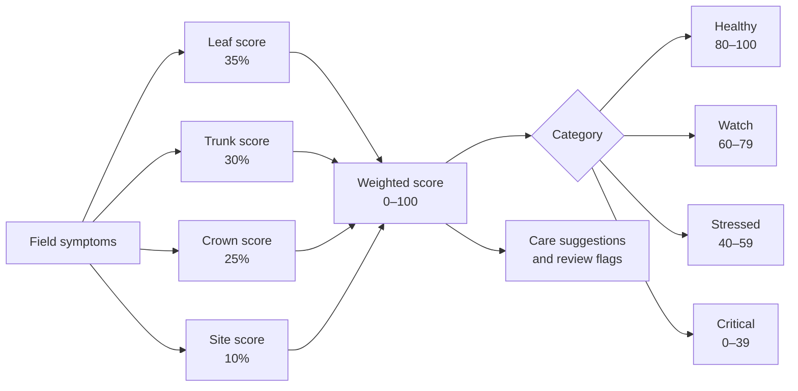
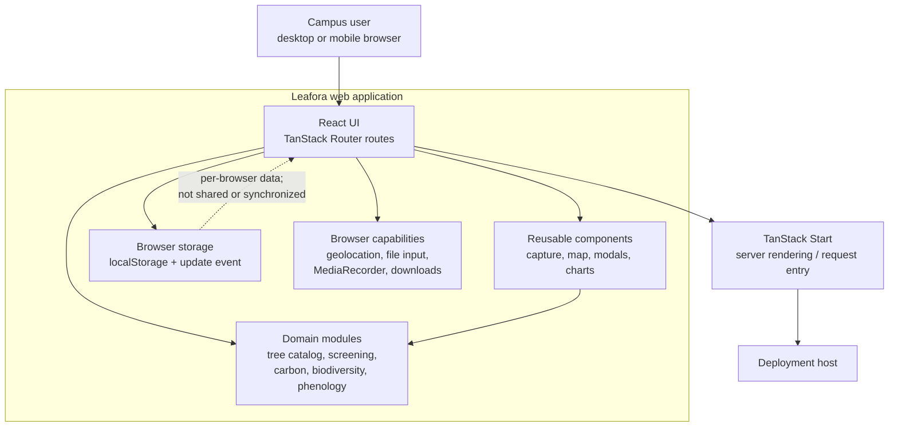
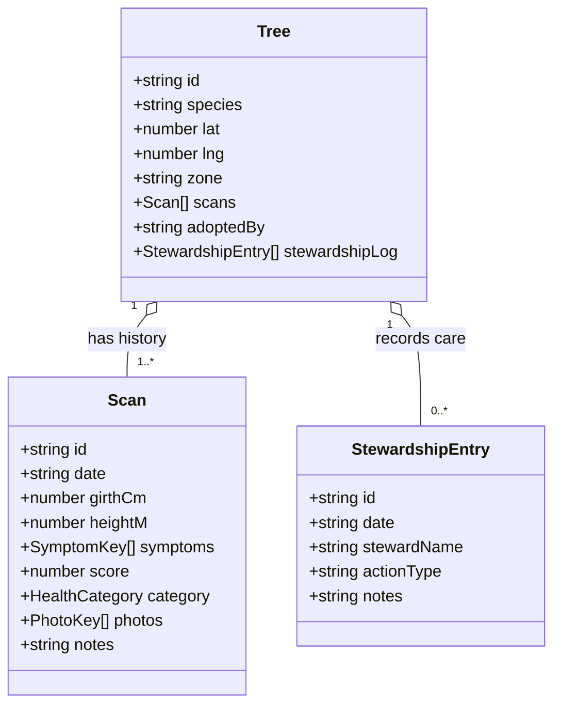

# Leafora

### A field-ready tree inventory and campus biodiversity platform

Leafora helps campus communities build a living record of their trees. Capture field observations, review health-screening results, explore tree records spatially, and estimate the ecosystem services provided by the campus canopy.

> **Project status:** Leafora is currently a frontend prototype and demonstration application. The repository includes seeded sample records and browser-local persistence. Its identification and health-screening logic is deterministic demonstration logic—not a deployed or validated machine-learning service. See [Current capabilities and limitations](#current-capabilities-and-limitations) before using its results for operational decisions.

**Built for:** campus sustainability teams, facilities and grounds staff, student researchers, and community tree stewards.

---

## Contents

- [Why Leafora](#why-leafora)
- [What you can do](#what-you-can-do)
- [How it works](#how-it-works)
- [Architecture](#architecture)
- [Data model](#data-model)
- [Technology](#technology)
- [Get started](#get-started)
- [Available commands](#available-commands)
- [Project structure](#project-structure)
- [Configuration](#configuration)
- [Testing and quality checks](#testing-and-quality-checks)
- [Production-readiness checklist](#production-readiness-checklist)
- [Current capabilities and limitations](#current-capabilities-and-limitations)
- [Contributing](#contributing)
- [License](#license)

## Why Leafora

Trees provide shade, cooling, carbon storage, habitat, and other benefits, but those assets are difficult to manage without consistent records. Leafora brings tree observations and campus-level views together in one web experience:

- **Record:** create a tree entry with photographs, measurements, symptoms, location, and field notes.
- **Review:** see a per-tree health timeline, screening summary, and suggested follow-up.
- **Explore:** filter campus records by health category and inspect hazard, cooling, or biodiversity views.
- **Estimate:** calculate illustrative carbon and ecosystem-benefit metrics from tree measurements.
- **Engage:** support stewardship activities, QR identity tags, phenology observations, and multilingual field use.

## What you can do

| Area | Capabilities |
| --- | --- |
| **Guided capture** | Add leaf, bark, crown, and optional flower/fruit photos; record girth, height, symptoms, zone, GPS, notes, and a voice note. |
| **Tree identification** | View candidate species and confidence values from the current demonstration identification engine. |
| **Health screening** | Review organ-level scores, a 0–100 summary, health category, symptom-based screening, care suggestions, and a Grad-CAM-style visual overlay. |
| **Tree records** | Browse a tree's measurements, scan history, health changes, QR identity, adoption status, and stewardship log. |
| **Campus inventory** | Explore health, hazard, cooling, and biodiversity layers; filter by health category; export CSV or GeoJSON. |
| **Ecosystem estimates** | Explore estimated biomass, carbon, CO₂ equivalent, oxygen, canopy, rainwater, cooling, and air-quality metrics. |
| **Community tools** | Try the native-planting advisor, phenology calendar, QR tag generator, adoption, and stewardship workflows. |
| **Field accessibility** | Use language selection, device geolocation where available, and browser-based voice recording. |

### Application routes

| Route | Purpose |
| --- | --- |
| `/` | Product introduction and capture/map entry points |
| `/capture` | Guided field capture and screening demonstration |
| `/map` | Campus inventory, map layers, filters, and exports |
| `/trees/:id` | Individual tree record, scan timeline, and stewardship |
| `/method` | Methodology, model concepts, and project approach |
| `/roadmap` | Feature showcase and future directions |
| `/login` | Sign-in interface placeholder; authentication is not connected |

## How it works

### Field capture flow

The capture screen guides a user through required photos and measurements, then produces a local tree record. GPS uses the browser's location API when the device reports a location within the configured campus bounds; otherwise the current demo supplies an approximate simulated campus coordinate.



### Screening and scoring concept

The current health-screening implementation translates selected symptoms into organ scores, applies a weighted score, assigns a category, and creates care guidance. The weights and category bands below describe the implemented scoring rule; they are not evidence of clinical or arboricultural validation.



### Ecosystem estimates

Tree dimensions and catalog wood-density values feed the app's allometric and derived-benefit calculations. Results are estimates and depend on assumptions in the implementation; they should not be represented as verified measurements, audited carbon credits, or financial valuations.

## Architecture

Leafora is a TypeScript React application using TanStack Start and file-based TanStack Router routes. The user interface and current domain calculations run in the browser. The server entry delegates requests to the TanStack Start server entry and normalizes selected server-rendering failures; it is not currently an application API or persistence backend.



### Architectural boundaries

- **Routes:** `src/routes/` defines pages using TanStack Router's file-based routing.
- **Shared UI:** `src/components/` contains product components and the `ui/` component library.
- **Domain logic:** `src/lib/` contains tree types and catalog data, deterministic screening and identification, and ecosystem calculations.
- **Client persistence:** tree inventory and related browser features use local storage; records do not synchronize between people or devices.
- **Server runtime:** `src/server.ts` wraps the TanStack Start server entry and handles request errors. No application database, authentication service, or inference API is configured.

## Data model

The main record is a **Tree**, with one or more **Scans** and optional stewardship information. The following diagram summarizes the central domain relationships; it is not a database schema.



## Technology

- **Runtime and language:** React 19, TypeScript, Node.js-compatible tooling
- **Application framework:** TanStack Start, TanStack Router, Vite
- **Styling:** Tailwind CSS v4
- **UI primitives:** Radix UI and locally composed components
- **Data and charts:** browser storage, Recharts, TanStack Query
- **Testing and linting:** Vitest, Testing Library, ESLint
- **Browser APIs:** Geolocation, MediaRecorder, file input, Blob downloads, and localStorage

## Get started

### Requirements

- Node.js **20.19+** or **22.12+**
- pnpm (the repository includes `pnpm-lock.yaml`)

### Install and run

```bash
git clone https://github.com/Swaroop494/leafora-bmsit.git
cd leafora-bmsit
pnpm install
pnpm dev
```

Open the local URL printed by Vite (typically `http://localhost:5173`).

### Production build and preview

```bash
pnpm build
pnpm preview
```

The production build is generated by Vite and TanStack Start. Configure the deployment platform to support the resulting TanStack Start server/runtime output; a static-file host alone may not provide the server-rendering behavior.

## Available commands

| Command | Description |
| --- | --- |
| `pnpm dev` | Start the local Vite development server |
| `pnpm build` | Create the production build |
| `pnpm build:dev` | Build using Vite's development mode |
| `pnpm preview` | Preview a production build locally |
| `pnpm lint` | Run ESLint across the project |
| `pnpm format` | Format project files with Prettier |
| `pnpm test` | Run the Vitest suite once |
| `pnpm test:watch` | Run Vitest in watch mode |

## Project structure

```text
.
├── public/                 # Public static assets
├── src/
│   ├── components/         # Product components and UI primitives
│   ├── hooks/              # Shared React hooks
│   ├── lib/                # Domain logic, catalog, and browser data layer
│   ├── routes/             # TanStack file-based routes
│   ├── routeTree.gen.ts    # Generated route tree; do not edit manually
│   ├── router.tsx          # Router and per-request QueryClient setup
│   ├── server.ts           # TanStack Start request wrapper
│   ├── start.ts            # Start server configuration
│   └── styles.css          # Global styles and design tokens
├── package.json            # Scripts and dependencies
├── pnpm-lock.yaml          # pnpm dependency lockfile
├── vite.config.ts          # Vite and TanStack Start configuration
├── vitest.config.ts        # Test configuration
└── tsconfig.json           # TypeScript configuration
```

## Configuration

There are no required environment variables or external API keys for the current local demo. The app uses sample campus records and browser APIs. If you add external services, document the required variables, where to obtain them, and safe secret-management practices here—never commit credentials.

## Testing and quality checks

Run the available checks before submitting a change:

```bash
pnpm lint
pnpm test
pnpm build
```

The repository uses strict TypeScript settings, but `package.json` does not currently define a dedicated type-check command. A build may exercise relevant compilation checks; add or document a standalone type-check command if your contribution introduces one.

## Production-readiness checklist

Leafora is not yet a multi-user commercial service. Before deploying it for real campus operations or offering it commercially, plan and implement the requirements appropriate to your deployment:

- **Backend and persistence:** replace browser-only storage with an authenticated API and durable database, including backups, migrations, access control, and synchronization.
- **Identity and authorization:** connect the sign-in screen to an identity provider; define roles for field users, reviewers, and administrators.
- **Real model inference:** integrate versioned identification and health models, provide provenance and confidence handling, and evaluate them on representative local data.
- **Human review and safety:** make arborist validation and escalation workflows explicit; do not treat automated screening as diagnosis or a hazard clearance.
- **Privacy and consent:** define policies for location, photographs, voice recordings, retention, access, and deletion; obtain consent where required.
- **Reliable field capture:** implement and test offline queues, upload retry, duplicate handling, and conflict resolution if offline operation is required.
- **Security and operations:** configure HTTPS, secure sessions, input validation, monitoring, error reporting, rate limits, and incident response.
- **Accessibility and localization:** verify keyboard and screen-reader access, contrast, responsive behavior, and translation coverage.
- **Scientific validation:** document sources, units, assumptions, calibration, uncertainty, and independent validation for ecological and carbon estimates.
- **Legal and commercial review:** confirm ownership, data and dataset rights, privacy obligations, and the project's license before redistribution or paid use.

## Current capabilities and limitations

The interface includes ambitious AI and field-work workflows, but the implementation in this repository has important boundaries:

- **Identification is a simulation.** The current TreeID module uses catalog features and deterministic seed-based logic; it does not run a trained computer-vision model on uploaded image pixels.
- **Health screening is rule-based demo logic.** Symptoms and deterministic sample selection drive disease labels, scores, and care suggestions. Grad-CAM-style points are generated illustrative coordinates, not model-derived explanations.
- **No authentication backend is connected.** `/login` validates the shape of the entered values locally and displays a placeholder success message.
- **Records are browser-local.** Inventory and related state use localStorage and are not shared across browsers, users, or devices. Clearing site data can remove them.
- **Uploaded media is not uploaded to a server.** Local object URLs used for photos and voice recordings are not durable media storage and may not remain usable after a reload.
- **Offline/PWA synchronization is not implemented.** The roadmap presents offline sync as a future/demo capability; there is no configured service worker and sync backend in this project.
- **Location fallback is simulated.** When device GPS is unavailable or outside the configured campus bounds, capture uses an approximate random coordinate within those bounds.
- **Map and metrics are illustrative.** Campus bounds, sample tree locations, hazard/cooling/biodiversity indicators, and ecosystem estimates require field verification and domain validation.
- **Care guidance is not professional advice.** Treatment decisions—especially chemical use, structural risk, pruning, and emergency response—must be reviewed by qualified professionals and follow local regulations.

## Contributing

Contributions are welcome. For a focused change:

1. Fork the repository and create a feature branch.
2. Keep changes scoped and follow the existing TypeScript and component conventions.
3. Add or update focused tests for behavior you change.
4. Run `pnpm lint`, `pnpm test`, and `pnpm build`.
5. Open a pull request describing the user impact, implementation, and any known limitations.

Do not commit credentials, private field data, or images without appropriate rights and consent. For model, dataset, or ecological-calculation changes, include sources and explain validation assumptions.

## License

No `LICENSE` file is currently present in this repository. Do not assume that the project is MIT-licensed or that commercial redistribution is permitted. Confirm the applicable license and third-party asset/model/data rights with the project maintainers before reuse.
